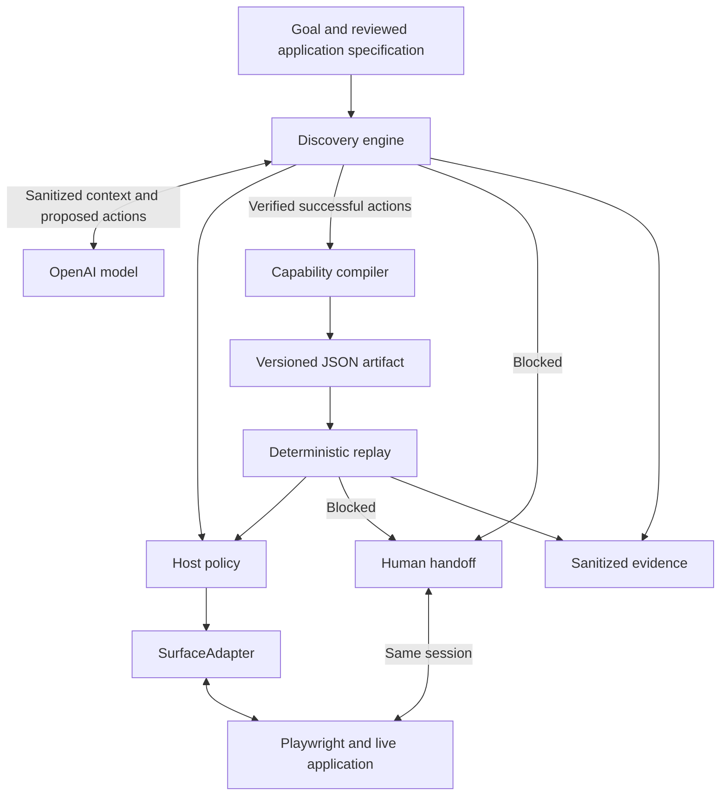

# Interface.ai Computer-Use Automation

An LLM works through a task in a browser. The system records the successful flow as a typed capability, then replays it with new inputs and no model calls.

The model chooses actions. Host policy controls what it can do, and checkpoints verify the result.

## Quick start

Requires Node.js 26.x and npm.

```bash
npm run setup
npm run gui
```

Open the URL printed by the GUI command. The default is `http://127.0.0.1:4310`.

Setup installs dependencies and Chromium, runs the checks, and stops on the first failure. To install and launch in one command:

```bash
npm run setup -- --launch-gui
```

Use `npm run setup -- --print-only` to inspect the commands before running them. For CLI usage:

```bash
npm run demo -- --help
```

## Scope

The target is a local member-lookup application, `synthetic-member-desk`, running in Chromium. The flow is member entry → search → detail → balance extraction. All member data is synthetic.

Two surfaces are available:

| Surface | Targeting |
| --- | --- |
| `standard` | Reviewed CSS IDs |
| `legacy` | Relationships to visible text in table-based markup, with unlabeled inputs and clickable spans. No IDs, roles, or test attributes. |

Live discovery uses OpenAI. Offline discovery follows a fixed script. Both save an artifact and replay it in a fresh browser context. Replay needs no API key.

Goal text is accepted through the CLI and GUI, but the supported task, controls, permissions, and output contract are fixed. The system does not attach to arbitrary applications or desktop windows. Desktop support and tenant reuse are design proposals in [REPORT.md](./REPORT.md).

## Install and verify

`npm run setup` runs these commands in order:

```bash
npm ci
npx playwright install chromium
npm run typecheck
npm test
npm run coverage
npm run build
npm run verify:evidence
```

On Linux, use `npx playwright install --with-deps chromium` if browser system dependencies are missing. Chromium is required for the full test suite and demos.

Validation on September 30, 2026 used Node.js 26.10.0: **282 tests passed across 20 files**, with **100% configured statement, branch, function, and line coverage**. Type checking and build also passed. Coverage measures TypeScript production modules; browser tests separately exercise `panel.js`. Tests make no authenticated model calls.

`verify:evidence` checks the saved evidence without starting a browser or calling a model. See [ELOG.md](./ELOG.md) for validation details.

| Command | Purpose |
| --- | --- |
| `npm run test:watch` | Watch mode |
| `npm run clean` | Remove `dist/` |
| `npm run demo -- ...` | Build and run a CLI command |
| `npm run gui` | Build and start the control panel |

## Run the GUI

```bash
npm run gui
```

To use another port:

```bash
GUI_PORT=4320 npm run gui
```

The panel supports offline discovery, live discovery, saved replay, and human handoff. Configure `OPENAI_API_KEY` and `MODEL_NAME` for live discovery. API keys are kept out of persisted GUI state.

The capability library reads saved artifacts from `evidence/`. It refreshes on connection, after a run, or when you click **Refresh**. Refresh manually if another process adds an artifact. Saved legacy capabilities also work through the library; select the legacy variant through the CLI when discovering a new capability.

State updates use one SSE connection at `/api/events`. Controls are disabled while disconnected. The panel reconnects automatically and loads current state. Commands use token-protected POSTs; `/api/state` is available for diagnostics. Elapsed time reflects the last state update.

After updating the code, restart the GUI and reload the page.

## Run the CLI

Run from the repository root with port 4173 available. Each command starts and stops its own application server and browser.

Offline discovery, live discovery, and replay are headless by default. Add `--headed` to see the browser and `--slow-mo 300` to slow the actions. Handoff commands already open a visible window. Leave it open until control returns to automation.

### Offline discovery

```bash
npm run demo -- offline --headed --slow-mo 300 \
  --port 4173 \
  --member DEMO-001 \
  --evidence evidence/runs
```

This runs the scripted flow, saves a capability, and replays it. It exercises the system without an API key. The script does not interpret the supplied goal.

### Live discovery

Set these variables in your shell or in a local, gitignored `.env` file:

```dotenv
OPENAI_API_KEY=replace-with-your-api-key
MODEL_NAME=gpt-4.1-mini
```

Use an API model ID. The included live run used `gpt-4.1-mini`; availability depends on your API project. Keep the key out of commits and logs. The demo loads `.env` automatically.

```bash
npm run demo -- discover --live \
  --target synthetic-member-desk \
  --goal "Find the supplied member and read their current savings balance" \
  --port 4173 \
  --member DEMO-001 \
  --evidence evidence/live-validation
```

Both `discover` and `--live` are required for billable calls. The model receives sanitized goal text and observations, then returns a structured decision. Host policy checks each action. Completion must pass the declared checkpoint before the artifact is saved and replayed.

### Saved replay

Use the included artifact:

```bash
npm run demo -- replay --headed --slow-mo 300 \
  --artifact evidence/submission/genuine-discovery/artifact.json \
  --port 4173 \
  --member DEMO-002 \
  --evidence evidence/runs
```

To replay your own discovery, use the actual `artifact.json` path printed by that run. Replay validates the artifact and input parameters before execution. It makes zero model calls and rejects goal, target, and variant overrides.

To exercise other outcomes, change the command as follows:

| Change | Expected result |
| --- | --- |
| `--member DEMO-999` | `BUSINESS_OUTCOME / MEMBER_NOT_FOUND` |
| `--member bad` | `BUSINESS_OUTCOME / INVALID_MEMBER_ID` |
| `--scenario slow` | Wait for the delayed response, then complete |
| `--scenario denied` | `FAILURE / PERMISSION_DENIED` |
| `--scenario expired` | `INTERVENTION_REQUIRED / SESSION_EXPIRED` |

### Legacy surface

```bash
npm run demo -- offline --variant legacy --port 4173 --evidence evidence/legacy-runs
npm run demo -- replay --artifact evidence/submission/legacy-discovery/artifact.json --port 4173 --member DEMO-002
```

The artifact uses structural relationships to find controls and extract the balance. Saved replay selects the recorded variant automatically. The included legacy discovery uses a scripted fixture and a real browser; it is separate from the genuine OpenAI discovery evidence.

### Human handoff during replay

```bash
npm run demo -- handoff \
  --artifact evidence/submission/genuine-discovery/artifact.json \
  --port 4173 \
  --member DEMO-001 \
  --evidence evidence/human-handoff
```

Automation pauses in the existing browser session. Click **Release session**, then type `resume` in the terminal. Any other answer cancels. Handback verifies readiness and resumes the blocked step without repeating completed actions.

For an expired session:

```bash
npm run demo -- replay \
  --artifact evidence/submission/genuine-discovery/artifact.json \
  --port 4173 --scenario expired --operator
```

Click **Release session**, wait for the member result, then type `resume`. Handback fails while the session remains expired. A closed browser requires a new run.

### Human handoff during discovery

```bash
npm run demo -- offline --operator --scenario discovery-handoff --port 4173
```

Click **Release session**, confirm **Ready**, then type `resume`. To use the model, replace `offline` with `discover --live` and configure the key and model.

Discovery keeps its original step limit and two-minute timeout during takeover. Handback does not grant approval, reset the budget, or authorize an uncertain retry. Human actions are recorded for audit; they are not automatically added to the capability.

### Options

| Option | Default / behavior |
| --- | --- |
| `--goal` | Discovery only; 1–2000 characters after trimming. Defaults to the member balance lookup. |
| `--target` | Discovery only; `synthetic-member-desk`. Arbitrary URLs are rejected. |
| `--variant` | Discovery only; `standard` or `legacy`. Defaults to `standard`. |
| `--member` | `DEMO-001`; `DEMO-002` is also valid. |
| `--port` | `4173`. Saved artifacts remain bound to their original origin and port. |
| `--evidence` | `evidence/runs`. Each run gets its own directory. |
| `--artifact` | Required for `replay` and `handoff`. |
| `--scenario` | `normal`, `slow`, `expired`, `denied`, `handoff`, or `discovery-handoff`. |
| `--headed` | Show Chromium. |
| `--slow-mo` | Delay actions by 0–5000 ms. Defaults to 0. |
| `--operator` | Enable human takeover during discovery or replay. |
| `--live` | Required with `discover`; rejected for other commands. |
| `--help` | Print usage without starting the application. |

## Architecture



The artifact contains typed inputs and outputs, ordered actions, target strategies, policy, checkpoints, recovery rules, and provenance. Zod validates the schema and references before replay. The format is independent of Playwright and the model provider.

Replay separates input validation, action construction, policy checks, and execution. The action builder resolves targets and binds values; the replay engine owns retries, checkpoints, and handoff. Shared value-binding and risk rules live in `domain/action.ts`.

Surface interfaces separate observation, targeting, execution, and session control. Playwright and an in-memory test adapter implement them. Discovery rejects custom actions; replay can delegate supported custom actions to an adapter.

See [REPORT.md](./REPORT.md) for design decisions and trade-offs, and [notes.md](./notes.md) for the engineering notes.

## Safety and data handling

Page content and model output cannot expand permissions. The system checks origins, routes, and action types against configured policy. Checkpoint reads use the same effective host policy. Browser request guards also check navigation and subresources.

| Action effect | Treatment |
| --- | --- |
| `read` | Observe without changing application state |
| `reversible_write` | Change state that can be undone |
| `irreversible_write` | Require approval and conservative recovery |
| `privileged` | Require approval and conservative recovery |

Submit and custom actions receive conservative treatment even if their declared effect understates the risk. If an action may have committed, replay verifies postconditions or escalates. It does not blindly repeat the action.

Unexpected dialogs remain flagged until verified human handback. Missing targets follow the step's recovery policy. Expired sessions can transfer to a human, but automation cannot resume until the application session is restored.

Sensitive invocation values stay in the host. Exported observations retain reviewed workflow text, masked target values, and session state. Raw titles, URLs, control trees, extracted action values, and error messages are omitted. Goal and rationale exports retain only supported instruction words and reviewed workflow vocabulary. Unknown tokens are omitted, which limits phrasing and diagnostic detail.

Checkpoint traces record whether conditions matched rather than copying raw values. Sensitive output classification supports CSS, accessibility, label, and structural targets. Ambiguous controls fail closed. Structural snapshots omit text, values, attributes, and URLs. Live callers still receive the declared outputs.

Human-action records include document numbers, numeric control paths, clicks, input/change/focus events, navigation, and non-printable control keys. They exclude typed values, labels, URLs, element IDs, and printable keystrokes.

Host configuration and output sensitivity declarations remain trust boundaries. Review both before adding another application. The tests establish protection for the cases covered; they do not prove that every possible secret is handled.

## Results and evidence

| Disposition | Meaning |
| --- | --- |
| `SUCCESS` | The success checkpoint passed and outputs were extracted. |
| `BUSINESS_OUTCOME` | An expected result, such as a missing member. |
| `RECOVERABLE` | A recoverable action failure exhausted its retry policy. |
| `INTERVENTION_REQUIRED` | Automation needs a human to proceed safely. |
| `FAILURE` | Validation, policy, checkpoint, targeting, or execution failed. |

The CLI prints the disposition, code, and evidence directory. Business outcomes and intervention requests can exit with status 0, so inspect the result rather than relying on the process exit code alone.

Run bundles include `manifest.json`, `replay.json`, the saved `artifact.json` when available, and structural snapshots. Discovery also records `discovery.json` and, on success, `discovery-manifest.json`. Failed discovery may have no artifact or replay result.

The trace includes step transitions, policy decisions, target resolution, action attempts, checkpoints, recovery, and evidence references. Terminal discovery results attempt a snapshot. Capture failures are recorded as `EVIDENCE_FAILURE` without replacing the original error. Invalid requests and concurrent-run rejections do not inspect the active session.

The [evidence index](./evidence/submission/README.md) identifies each run's model and operator source. It includes genuine OpenAI discovery, changed-input replay, business outcomes, session expiry and recovery, human takeover, privacy failures, and the legacy surface.

```bash
npm run verify:evidence
```

Only `evidence/submission/` is tracked. Generated runs and archives are ignored. Checksums verify file integrity; they do not authenticate provider execution. Public repository access, remote CI, and email submission remain unverified delivery items.

## Troubleshooting

| Symptom | Action |
| --- | --- |
| No browser window | Add `--headed --slow-mo 300`. |
| `ARTIFACT_READ_FAILED` | Check the path. The included example is `evidence/submission/genuine-discovery/artifact.json`. |
| `ARTIFACT_INVALID` | Supply `artifact.json`, not a manifest or replay log. |
| Missing `SHA256SUMS.json` | Restore the complete `evidence/submission/` directory before verifying. |
| Chromium missing or launch fails | Run `npx playwright install chromium`; on Linux, use `--with-deps` if needed. |
| Local server cannot start | Free the selected port. Saved replay must use the artifact's original port. |
| Missing model/key or `Demo stopped` | Check command syntax, `OPENAI_API_KEY`, `MODEL_NAME`, and saved evidence. Raw errors are suppressed. |
| `MODEL_HTTP_400` with parameter `input` | Use the current provider implementation, which supplies the required user message and JSON instruction. |
| `MODEL_HTTP_400` with `invalid_json_schema` | Use the current structured-output schema. Keep host validation enabled. |
| `MODEL_HTTP_401`, `403`, or `404` | Check the key, project access, and exact model ID. |
| `MODEL_HTTP_429` | Check the recorded error code. Rate limits and exhausted quota need different fixes; null metadata does not identify the cause. |
| `MODEL_INVALID_DECISION` | The response failed local validation. Inspect sanitized provider metadata. |
| `ARTIFACT_ORIGIN_MISMATCH` | Use the recorded origin and port, or discover a new artifact. |
| `BUSINESS_OUTCOME` or `INTERVENTION_REQUIRED` | Read the result code and trace. These can be expected outcomes. |

Provider diagnostics retain sanitized error codes and request IDs. References: [API errors](https://developers.openai.com/api/docs/guides/error-codes) and [structured outputs](https://developers.openai.com/api/docs/guides/structured-outputs).

## Project structure

```text
src/
  artifact/    Schema and validated loading
  demo/        Local application and CLI
  discovery/   Model loop and capability compilation
  domain/      Shared contracts and action rules
  evidence/    Sanitization and persistence
  gui/         Control panel and state streaming
  hitl/        Human intervention and control transfer
  policy/      Authority checks
  replay/      Execution and checkpoints
  runtime/     Errors and deadlines
  surface/     Adapter interfaces, test fake, and Playwright
test/          Unit and browser integration tests
REPORT.md      Assignment design report
ELOG.md        Implementation and validation history
P0_SECURITY_VALIDATION.md  Security checks and runtime evidence
notes.md       Engineering notes
```

## Next steps

Before production use: persistent job and artifact storage, managed secrets, tenant isolation, authenticated operator access, and stronger browser/session management. Validate compatibility and error indicators for each application before enabling unattended replay.

## License

See [LICENSE](./LICENSE).
