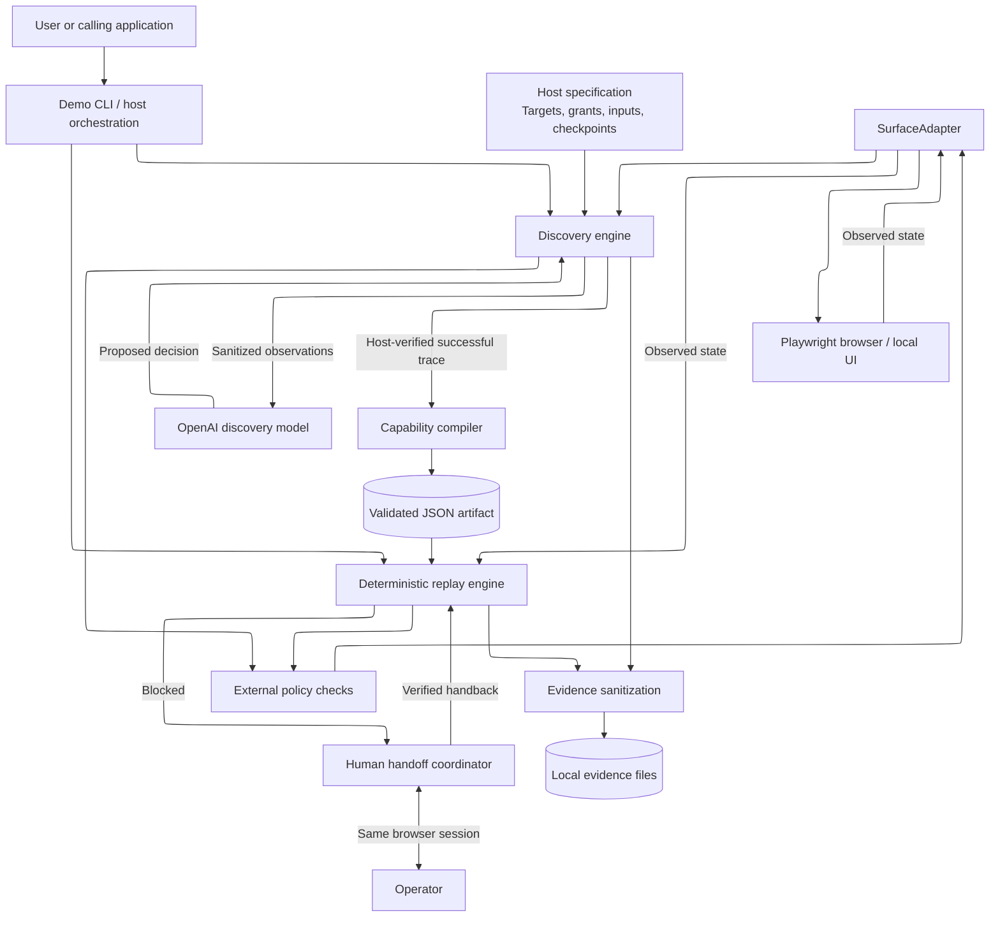
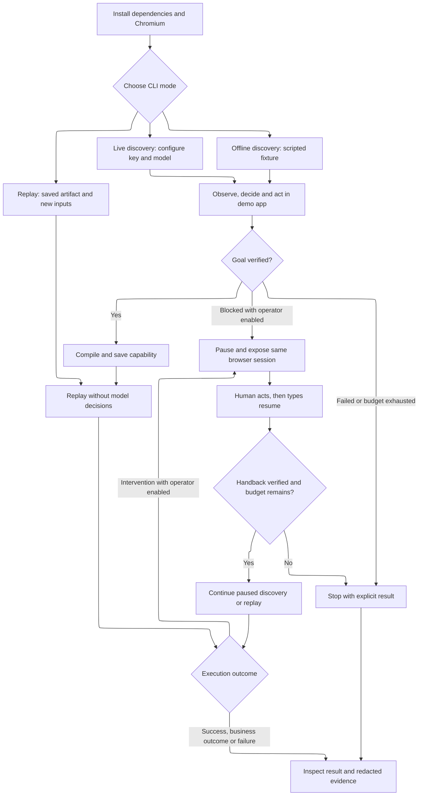

# Interface.ai Computer-Use Automation

## TLDR;

From a fresh checkout, run the setup script:

```bash
npm run setup
```

The setup script outlines the plan, shows each step in cyan, shows each command in blue parentheses, updates the active step in place, marks passes in green, marks failures in red, and stops on the first failure. Under the hood it runs these steps in order:

```bash
npm ci
npx playwright install chromium
npm run typecheck
npm test
npm run coverage
npm run build
npm run verify:evidence
```

Then start the GUI:

```bash
npm run gui
```

Open the local URL printed by `npm run gui` to use the browser control panel. To run setup and launch the GUI in one command, use `npm run setup -- --launch-gui`. To preview the installation steps without running them, use `npm run setup -- --print-only`. For terminal-only use, run `npm run demo -- --help`, then run one of the demo commands below.

This project uses an LLM to learn a task in a browser, saves the steps as a reusable capability, and runs that capability again with new inputs without calling the model.

The main design rule is:

> The model may discover behavior, but it does not define authority.

The model proposes actions during discovery. The application checks those actions against its policy and verifies the result. Replay follows the saved steps, checks progress, and stops or asks for help when it cannot safely continue.

## Current status

The latest fixes prevent sensitive values from appearing in failed-replay diagnostics, let a human take over during discovery, and make the saved evidence verifiable from a checkout.

The [included evidence](./evidence/submission/README.md) covers a real OpenAI discovery run, replay, human takeover, and failure cases. Each run identifies whether it used a model, a scripted fixture, or an automated operator. Publishing the repository, checking remote CI, and submitting the link are still separate delivery steps.

## Current scope

The demo runs from the terminal or the local GUI and works with a local member-lookup app in Chromium. Live discovery uses OpenAI; offline discovery follows a script so you can try the flow without an API key. You can replay a saved capability with another member ID or take over the browser when automation needs help.

The demo comes with a predefined task and a known set of controls. Support for other applications and a graphical task-entry window would be future work. It cannot currently attach to an arbitrary browser or desktop window. The commands below generate the JSON artifacts for you; you do not need to edit them.

## What it does

- A Zod-validated, portable capability artifact format
- Model-assisted workflow discovery with route and origin constraints
- Deterministic replay with no model dependency
- Ordered, artifact-defined target resolution strategies
- Preconditions, postconditions, success checks, and business outcomes
- Policy enforcement for targets, routes, action types, and human approvals
- Conservative handling of retries and ambiguous commits
- Explicit success, failure, recoverable, business-outcome, and intervention results
- Evidence capture and sensitive-value redaction
- Human-in-the-loop pause, handoff, and control restoration
- Browser support through Playwright plus an in-memory fake adapter for tests

## Architecture Overview

### High-level architecture



Discovery can also pause for human takeover when operator mode is enabled. Both paths keep the same browser session and verify its state before resuming.

### User workflow



After a human returns control, discovery still has to verify the goal before saving a capability. Resuming does not add permissions or reset the time and step limits.

The saved artifact connects discovery to replay. It defines the inputs, outputs, steps, controls, permissions, checks, and recovery rules. It also records where the capability came from. Its format is independent of Playwright and the model provider.

## Safety model

The system treats observed UI content as untrusted data. Authority comes from the capability policy and invocation context, never from text encountered on screen.

Each action declares an effect:

| Effect | Meaning |
| --- | --- |
| `read` | Observes state without changing it |
| `reversible_write` | Changes state that can be safely undone |
| `irreversible_write` | May create a non-reversible external effect |
| `privileged` | Requires elevated authority or special handling |

High-risk actions receive evidence capture before and after execution. Risky retries are rejected by artifact validation unless ambiguous-commit reconciliation is explicitly required. If the system cannot prove whether an action committed, it requests intervention instead of blindly retrying.

## Requirements

- Node.js 26.x (package engines, CI, and `.nvmrc` select Node 26)
- npm
- Playwright Chromium for browser tests and demos
- An OpenAI API key and Responses API model ID for live discovery only

Current verification uses Node.js 26.10.0. Older validation records used Node.js 24.21.0. The project is a private ESM package using TypeScript, Zod, Playwright, and Vitest.

## Install

From the project directory, install the dependencies and Chromium:

```bash
npm ci
npx playwright install chromium
```

On Linux environments needing browser system dependencies, use `npx playwright install --with-deps chromium`. Browser installation is required for the full test suite as well as the demo.

## Verify the project

```bash
npm run typecheck
npm test
npm run coverage
npm run build
npm run verify:evidence
```

Additional commands:

| Command | Purpose |
| --- | --- |
| `npm run test:watch` | Run tests in watch mode |
| `npm run clean` | Remove compiled output |
| `npm run setup` | Install dependencies, install Chromium, verify, build, and verify evidence while printing each command |
| `npm run demo -- ...` | Build, then execute a demo command |
| `npm run gui` | Build, then start the local browser control panel |

Compiled JavaScript is written to `dist/`. Coverage enforces 100% statements, branches, functions, and lines for the configured source scope. Tests and offline demos do not make authenticated model calls.

Current validation passes type checking, build, and 241 tests with 100% configured coverage. `npm run verify:evidence` verifies 81 hashed files, nine parsed artifacts, expected outcomes, and portable snapshot references without opening a browser or calling a model. See [P0 security validation](./P0_SECURITY_VALIDATION.md) for dates, commands, and limits.

## Run the GUI

```bash
npm run gui
```

The GUI builds the project, starts a local control panel on `http://127.0.0.1:4310` by default, and prints the exact URL. Set `GUI_PORT` before launching if that port is unavailable.

The control panel can run offline scripted discovery, live OpenAI discovery after you configure `OPENAI_API_KEY` and `MODEL_NAME`, saved replay, and same-session handoff. It scans supported saved capabilities from `evidence/`, keeps sensitive API keys out of persisted GUI state, and uses the same local-origin, policy, replay, and handoff checks as the CLI.

```bash
GUI_PORT=4320 npm run gui
```

## Run the demo

`npm run demo` or `npm run demo -- --help` prints usage. Each execution command starts and stops its own local application and browser. Run from the repository root with port 4173 available; a separate application server is unnecessary.

Offline, discovery, and replay are headless by default. Add `--headed` to show Chromium and `--slow-mo 300` to slow Playwright operations. The browser closes when the run finishes. Handoff and `--operator` already open a visible browser; leave it open until handback completes.

### Offline discovery and replay

```bash
npm run demo -- offline --headed --slow-mo 300 --port 4173 --member DEMO-001 --evidence evidence/runs
```

This follows a scripted discovery flow, saves a capability, and replays it in a fresh browser context. It is a way to try the full flow without an API key. Use live discovery below to have the model choose the actions.

### Live OpenAI discovery

Set `OPENAI_API_KEY` and `MODEL_NAME` in your shell environment or create a local, gitignored `.env` file:

```dotenv
OPENAI_API_KEY=replace-with-your-api-key
MODEL_NAME=gpt-4.1-mini
```

Use an API model ID, not a display label. `gpt-4.1-mini` is the model verified in this repository's genuine run; access depends on your API project. Keep the key out of commits and shared logs. The demo loads `.env` through Node's `--env-file-if-exists` option.

```bash
npm run demo -- discover --live \
  --port 4173 \
  --member DEMO-001 \
  --evidence evidence/live-validation
```

Both `discover` and `--live` are required to make billable model calls. Discovery uses the Responses API with strict structured output. External policy checks each decision, and the host independently verifies completion. A successful discovery saves its artifact and discovery evidence before automatic deterministic replay.

### Options

| Option | Default / behavior |
| --- | --- |
| `--member` | `DEMO-001`; `DEMO-002` is another valid synthetic member |
| `--port` | `4173`; saved artifacts remain bound to their original origin and port |
| `--evidence` | `evidence/runs`; each execution gets a separate run directory |
| `--artifact` | Required saved artifact path for `replay` and `handoff` |
| `--scenario` | `normal`; also `slow`, `expired`, `denied`, `handoff`, and `discovery-handoff` |
| `--headed` | Show Chromium during offline/discovery/replay |
| `--slow-mo` | Delay Playwright operations by 0-5000 ms; default 0 |
| `--operator` | Enable visible human takeover during discovery or replay |
| `--help` | Show usage without starting a server/browser |
| `--live` | Required only for `discover`; rejected for other commands |

## Minimal replay example

Use the included genuine artifact, or replace its path with `artifact.json` from your own successful discovery:

```bash
npm run demo -- replay --headed --slow-mo 300 \
  --artifact evidence/submission/genuine-discovery/artifact.json \
  --port 4173 \
  --member DEMO-002 \
  --evidence evidence/runs
```

For a new offline run, use the exact `evidence/runs/RUN_ID/artifact.json` path printed by that run. A deleted, mistyped, or example-only run ID is not a valid artifact path. Replay loads the saved artifact through `parseCapabilityArtifact` and makes zero model calls. It requires no API key. Invalid cross-references, undeclared inputs, and unsafe retry policies fail validation before execution.

To exercise distinct runtime outcomes, repeat the replay command with `--member DEMO-999` for `BUSINESS_OUTCOME / MEMBER_NOT_FOUND`, or add `--scenario expired` with a valid member for `INTERVENTION_REQUIRED / SESSION_EXPIRED`.

### Same-session human handoff

```bash
npm run demo -- handoff \
  --artifact evidence/submission/genuine-discovery/artifact.json \
  --port 4173 \
  --member DEMO-001 \
  --evidence evidence/human-handoff
```

This opens a headed browser and pauses automation. In that same window, click **Release session**, then type `resume` in the terminal to return control. Any other answer cancels. The command selects the handoff scenario automatically. Automated handoff coverage and a genuine operator takeover/handback run are verified. The successful run resumed the blocked step without repeating prior actions; see the validation record.

### Discovery-time human handoff

```bash
npm run demo -- offline --operator --scenario discovery-handoff --port 4173
```

This is an explicitly scripted fixture with real browser/operator control and no API charges. To use a model, replace `offline` with `discover --live` and configure the key/model. The original discovery step and two-minute time budgets remain active during takeover. Click **Release session**, confirm **Ready**, leave the window open, and type `resume`.

After verified handback, discovery reobserves the same page and continues without replaying its prefix. An exhausted budget, approval requirement, or failed/uncertain action cannot be bypassed by handback. Cancellation and failed readiness checks are recorded and stop the run. Human actions are audit records, not silently compiled automation steps.

## Evidence and validation

The CLI prints the disposition, code, and evidence directory. Inspect the persisted result rather than relying only on the process exit status: expected business outcomes and intervention results can exit with status 0.

Run bundles contain `manifest.json`, `replay.json`, the saved `artifact.json` when available, and structural snapshots. Discovery additionally records `discovery.json` and `discovery-manifest.json`, including sanitized provider provenance. Failed discovery may have no artifact or replay result.

| Completed validation | Included evidence |
| --- | --- |
| Genuine OpenAI discovery and automatic replay | [genuine-discovery](./evidence/submission/genuine-discovery/) |
| Same saved artifact, another input | [second-input-replay](./evidence/submission/second-input-replay/) |
| Not found and session expiry | [not-found](./evidence/submission/not-found/), [expired-session](./evidence/submission/expired-session/) |
| Scripted discovery with genuine human takeover | [discovery-handoff](./evidence/submission/discovery-handoff/) |
| Automated replay takeover and rejected handback | [replay-handoff](./evidence/submission/replay-handoff/), [rejected-handback](./evidence/submission/rejected-handback/) |
| Fixed sensitive-output failure | [privacy-regression](./evidence/submission/privacy-regression/) |

Sensitive invocation values stay host-bound. Checkpoint diagnostics register sensitive target/signal values and sanitize text before returning trace strings, even if extraction later fails. Bundle sanitization runs before persistence; structural snapshots omit page text, values, attributes, and URLs. Sensitive-target classification currently supports reviewed standard CSS selectors and fails closed otherwise. Scans cover specified values and patterns, not every possible secret.

Only `evidence/submission/` is selected for repository tracking. Other generated runs and archives remain ignored. The included provenance records disclose path normalization; checksums and expected outcomes are verified by `npm run verify:evidence`.

## Troubleshooting

| Symptom | Check / next step |
| --- | --- |
| No browser appears for offline/discover/replay | Add `--headed --slow-mo 300`; headless is the default. |
| `ARTIFACT_READ_FAILED` | The file is missing or unreadable. Use `evidence/submission/genuine-discovery/artifact.json`, or an existing successful run. |
| `ARTIFACT_INVALID` | Supply the saved capability file, not a manifest, replay log, or incomplete discovery. |
| Missing `SHA256SUMS.json` | The evidence checkout is incomplete. Restore the complete `evidence/submission/` directory; do not generate hashes over an incomplete selection. |
| Chromium executable missing or browser launch fails | Run `npx playwright install chromium`; on Linux install required system dependencies with `--with-deps`. |
| Local server cannot start | Free the chosen port. For saved replay, preserve the artifact's original port. |
| Missing model/key or generic `Demo stopped` | Check command syntax, `OPENAI_API_KEY`, `MODEL_NAME`, and the printed evidence directory. The wrapper deliberately suppresses raw errors. |
| `MODEL_HTTP_400`, parameter `input` | Use the current provider implementation, which sends an explicit user message and JSON instruction. Inspect allowlisted provider metadata. |
| `MODEL_HTTP_400`, `invalid_json_schema`, parameter `text.format.schema` | Use the corrected provider schema: object root, nested `anyOf`, strict branches, and required nullable arguments. Do not weaken host validation. |
| `MODEL_HTTP_401`, `403`, or `404` | Check the key, API project access, and exact API model ID. |
| `MODEL_HTTP_429` | Inspect recorded error code. Rate limits and exhausted quota require different remedies; check project billing/limits before retrying. Null metadata does not identify the cause. |
| `MODEL_INVALID_DECISION` | The response failed local decision validation. HTTP 200 alone does not establish discovery success; use the current structured-output implementation. |
| `ARTIFACT_ORIGIN_MISMATCH` | Replay on the origin/port used for discovery, or create a new artifact for the intended origin. |
| `BUSINESS_OUTCOME` or `INTERVENTION_REQUIRED` | Read the code and trace. These are explicit execution dispositions, not necessarily CLI failures. |

Provider free-form error messages and raw malformed decisions are intentionally excluded from persisted diagnostics. Preserve the sanitized error code and request ID when investigating. See the official [API error guide](https://developers.openai.com/api/docs/guides/error-codes) and [structured outputs guide](https://developers.openai.com/api/docs/guides/structured-outputs).

## Execution outcomes

Replay returns structured results rather than treating every non-success state as an exception:

- `SUCCESS`: the declared success checkpoint passed and outputs were extracted
- `BUSINESS_OUTCOME`: an expected domain condition was detected, such as an unavailable item
- `RECOVERABLE`: a declared recoverable action failure exhausted its retry policy
- `INTERVENTION_REQUIRED`: automation cannot safely continue without a human
- `FAILURE`: policy, validation, checkpoint, target-resolution, or action execution failed

The trace records step transitions, session state, policy decisions, target resolution, action attempts, recovery, checkpoint evaluations, and evidence references.

## Project structure

```text
src/
  artifact/    Capability schema and validated loading
  demo/        Local synthetic application and executable CLI
  discovery/   Model-assisted discovery and capability compilation
  domain/      Shared execution contracts
  evidence/    Redaction and JSON evidence persistence
  hitl/        Human intervention and control transfer
  policy/      Runtime authority evaluation
  replay/      Deterministic execution and checkpoint evaluation
  surface/     Surface abstraction, fake adapter, and Playwright adapter
test/          Unit and end-to-end vertical-slice tests
ELOG.md        Dated implementation progress and architectural decisions
P0_SECURITY_VALIDATION.md  Security checks and genuine runtime evidence
REPORT.md      Seven-section design report and implementation limits
notes.md       Engineering notebook and design rationale
```

## What I would build next

Before using this in production, I would add persistent job and artifact storage, managed secrets, tenant isolation, an operator interface, and stronger browser/session management. The current project focuses on discovery, replay, policy checks, and human handoff for one application.

## Design rules

1. Replay does not depend on an LLM or model SDK.
2. Target resolution is ordered and declared by the artifact.
3. Important state is verified before and after actions.
4. Policy remains external to model output and observed UI content.
5. Ambiguous irreversible effects are reconciled or escalated, never blindly repeated.
6. Human intervention uses explicit pause, handoff, and control restoration.

For the assignment design write-up, see [`REPORT.md`](./REPORT.md). For deeper design notes and requirement mapping, see [`notes.md`](./notes.md).

## License

See [`LICENSE`](./LICENSE).
